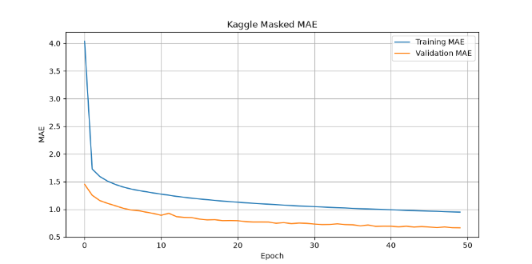

# Ventilator Pressure Prediction

**Vorhersage des Atemwegsdrucks eines Beatmungsgeräts mit einem CNN + Bidirectional-GRU-Netz (TensorFlow / Keras)**


Lösung für die Kaggle-Competition
[**Google Brain – Ventilator Pressure Prediction**](https://www.kaggle.com/competitions/ventilator-pressure-prediction).
Das Modell sagt für jeden Atemzug den Druck in der Lunge für alle 80 Zeitschritte voraus – ausschließlich aus den Steuersignalen des Beatmungsgeräts und den Lungenparametern.

---

## Inhaltsverzeichnis

1. [Projektziel & Zeitraum](#projektziel--zeitraum)
2. [Hintergrund & Problemstellung](#hintergrund--problemstellung)
3. [Datensatz](#datensatz)
4. [Lösungsansatz im Überblick](#lösungsansatz-im-überblick)
5. [Feature Engineering](#feature-engineering)
6. [Modellarchitektur](#modellarchitektur)
7. [Training & Evaluation](#training--evaluation)
8. [Ergebnisse](#ergebnisse)
9. [Installation & Nutzung](#installation--nutzung)
10. [Projektstruktur](#projektstruktur)
11. [Design-Entscheidungen](#design-entscheidungen)
12. [Einschränkungen & mögliche Verbesserungen](#einschränkungen--mögliche-verbesserungen)
13. [Was ich gelernt habe](#was-ich-gelernt-habe)
14. [Lizenz](#lizenz)

---

## Projektziel & Zeitraum

Ziel dieses Projekts war es, das Wissen aus den von mir absolvierten **Kaggle-Kursen** in einem zusammenhängenden Projekt zu **kombinieren und anzuwenden**.

Das **Hauptziel** war dabei nicht ein möglichst niedriger Fehlerwert, sondern eine **saubere Struktur und ein sauberer Arbeitsablauf**: von der Datenvorbereitung über Feature Engineering und Modelltraining bis zur validierten Abgabedatei.

Der erreichte MAE ist noch verbesserungsfähig. Die weitere Optimierung des Wertes sehe ich als Möglichkeit, in Zukunft zusätzlich dazuzulernen.

| | |
|---|---|
| **Projektstart** | 16.11.2026 |
| **Projektabschluss** | 17.11.2026 |

---

## Hintergrund & Problemstellung

Mechanische Beatmungsgeräte retten Leben, müssen aber von geschultem Personal eingestellt und überwacht werden. Zum Training und zur Entwicklung neuer Steuerungen werden aufwendige Simulatoren benötigt, die teuer und rechenintensiv sind.

Die Competition stellt daher folgende Frage: **Kann ein neuronales Netz das Verhalten einer beatmeten Lunge lernen**, sodass es als schneller, datengetriebener Ersatz für einen physikalischen Simulator dienen kann?

Die Daten stammen aus einem Test-Lungen-Aufbau, der über ein Beatmungsgerät gesteuert wurde:

- **Inspiratorisches Magnetventil** (`u_in`): steuert, wie viel Luft in die Lunge strömt (0–100)
- **Exspiratorisches Ventil** (`u_out`): offen (1) oder geschlossen (0)
- **Lungenattribute** `R` (Atemwegswiderstand) und `C` (Dehnbarkeit / Compliance)
- **Zielgröße** `pressure`: der Atemwegsdruck in der Lunge

**Aufgabe:** Sage zu jedem Zeitschritt eines Atemzugs den Druck (`pressure`) vorher.

**Metrik:** Mean Absolute Error (MAE) – **nur über die Inspirationsphase** (`u_out == 0`) berechnet. Die Ausatemphase fließt nicht in den Score ein.

---

## Datensatz

| Eigenschaft | Wert |
|---|---|
| Trainingsdaten | `train.csv` (6.036.000 Zeilen, 75.450 Atemzüge) |
| Testdaten | `test.csv` (4.024.000 Zeilen, 50.300 Atemzüge) |
| Länge eines Atemzugs | exakt **80 Zeitschritte** |
| Gruppierung | `breath_id` |

**Spalten:**

| Spalte | Beschreibung |
|---|---|
| `id` | eindeutige Zeilen-ID (global) |
| `breath_id` | ID des Atemzugs |
| `R` | Atemwegswiderstand (cmH₂O/L/s) |
| `C` | Lungen-Compliance (mL/cmH₂O) |
| `time_step` | Zeitpunkt der Messung (s) |
| `u_in` | Steuersignal des inspiratorischen Ventils (0–100) |
| `u_out` | Steuersignal des exspiratorischen Ventils (0 = zu, 1 = offen) |
| `pressure` | Zielgröße: Atemwegsdruck (cmH₂O) – nur im Training |

>  Die Daten werden aus Lizenzgründen **nicht** in diesem Repository mitgeliefert.
> Sie können über die [Competition-Seite](https://www.kaggle.com/competitions/ventilator-pressure-prediction/data) heruntergeladen werden.

---

## Lösungsansatz im Überblick

Jeder Atemzug wird als **Zeitreihe der Länge 80** betrachtet. Das Modell bekommt die gesamte Sequenz und gibt für jeden Zeitschritt einen Druckwert aus (*Sequence-to-Sequence-Regression*).

```mermaid
flowchart LR
    A[train.csv / test.csv] --> B[Sortieren nach<br/>breath_id, time_step]
    B --> C[Feature Engineering<br/>pro Atemzug]
    C --> D[Reshape zu<br/>N × 80 × 13]
    D --> E[Split nach<br/>ganzen Atemzügen]
    E --> F[Normalization-Layer]
    F --> G[Conv1D ×2]
    G --> H[Bidirectional GRU]
    H --> I[Dense + Dropout]
    I --> J[Dense 1<br/>Druck pro Zeitschritt]
    J --> K[submission.csv]
```



Kernpunkte:

- **Sequenzmodell statt Tabellenmodell:** Der Druck hängt stark von der *Vorgeschichte* des Luftflusses ab – ein Modell, das die ganze Sequenz sieht, ist hier naheliegend.
- **Physikalisch motivierte Features:** kumulierter und integrierter Luftfluss bilden die „eingeatmete Luftmenge" nach.
- **Loss mit Maske:** Das Training konzentriert sich exakt auf die Phase, die auch bewertet wird (`u_out == 0`).
- **Sauberer Split:** Validierung erfolgt auf *ganzen Atemzügen*, um Datenleck zwischen Zeilen desselben Atemzugs zu vermeiden.

---

## Feature Engineering

Alle Features werden **pro `breath_id`** berechnet (`groupby`), nachdem die Daten nach `breath_id` und `time_step` sortiert wurden.

| Feature | Beschreibung | Motivation |
|---|---|---|
| `R`, `C` | Lungenparameter | bestimmen die Lungenphysik |
| `time_step` | Zeitpunkt im Atemzug | Phase innerhalb des Atemzugs |
| `u_in`, `u_out` | Rohsignale | Steuerung des Geräts |
| `u_in_cumsum` | kumulierte Summe von `u_in` | grobe „eingeatmete Luftmenge" |
| `area` | zeitlich gewichtetes Integral `Σ u_in · Δt` | physikalisch genauere Luftmenge (berücksichtigt unregelmäßige Zeitabstände) |
| `u_in_diff1` | 1. Differenz von `u_in` | Änderungsrate des Luftflusses |
| `u_in_diff2` | 2. Differenz von `u_in` | „Beschleunigung" des Luftflusses |
| `u_in_lag1`, `u_in_lag2` | verzögerte Werte von `u_in` | explizites Kurzzeitgedächtnis |
| `log_u_in` | `log1p(u_in)` | dämpft große Werte, stabilisiert Verteilung |
| `u_in_max` | Maximum von `u_in` im Atemzug | Kontext über den gesamten Atemzug |

Insgesamt gehen **13 Features** pro Zeitschritt in das Modell ein. Zur Speicherersparnis werden alle Features nach `float32` konvertiert.

---

## Modellarchitektur

```
Input (80, 13)
   │
Normalization (adaptiert auf Trainingsdaten)
   │
Conv1D(64, kernel=5, same, swish)   ← lokale Muster
Conv1D(64, kernel=3, same, swish)
   │
Bidirectional(GRU(32, return_sequences=True))   ← zeitliche Abhängigkeiten
   │
Dense(64, swish)
Dropout(0.15)
   │
Dense(1)  →  Druck pro Zeitschritt  (80, 1)
```

**Warum diese Kombination?**

- **Conv1D** extrahiert lokale Muster im Luftfluss (z. B. Anstiege, Plateaus, Sprünge).
- **Bidirectional GRU** modelliert den zeitlichen Zusammenhang in beide Richtungen. Das ist hier zulässig, da der komplette Atemzug zum Vorhersagezeitpunkt vorliegt (kein Echtzeit-Einsatz).
- **Swish-Aktivierung** liefert in der Praxis häufig glattere Gradienten als ReLU.
- **Dropout (0.15)** als leichte Regularisierung.

---

## Training & Evaluation

| Parameter | Wert |
|---|---|
| Sequenzlänge | 80 |
| Batch Size | 128 |
| Max. Epochen | 50 |
| Optimizer | Adam, Lernrate `5e-4` |
| Loss | MAE (mit `sample_weight`-Maske) |
| Validierung | 10 % der Atemzüge (zufällig, Seed 42) |
| Zufalls-Seed | `42` (NumPy & TensorFlow) |

### Die Kaggle-Maske

Die Competition bewertet nur die Inspirationsphase. Deshalb wird eine Gewichtsmatrix verwendet:

```python
train_weights = (X_train[:, :, u_out_index] == 0).astype(np.float32)
```

Zeitschritte mit `u_out == 1` erhalten Gewicht 0 – sie tragen weder zum Loss noch zur Metrik `masked_mae` bei. Der finale Validierungs-Score wird zusätzlich manuell mit NumPy nachgerechnet:

```python
kaggle_mae = errors[mask].mean()
```

### Callbacks

- **EarlyStopping** – überwacht `val_masked_mae`, Geduld 8 Epochen, stellt die besten Gewichte wieder her
- **ReduceLROnPlateau** – halbiert die Lernrate nach 3 Epochen ohne Verbesserung (Minimum `1e-5`)
- **ModelCheckpoint** – speichert das beste Modell als `best_pressure.keras`

### Sicherheitsprüfungen im Code

- Es wird geprüft, dass **jeder Atemzug exakt 80 Messpunkte** hat, bevor umgeformt wird.
- Die Test-Vorhersagen werden über die **ursprüngliche `id`** zugeordnet; fehlende Vorhersagen lösen einen Fehler aus.

---

## Ergebnisse

| Metrik | Wert |
|---|---|
| Validation MAE (nur `u_out == 0`) | **0,6651** |

**Trainingsverlauf:**



**Einordnung des Verlaufs:**

- Training und Validierung sinken stetig und ohne Instabilität – es gibt keine Anzeichen für Overfitting.
- Der Validation-MAE liegt unter dem Training-MAE. Das ist hier plausibel: Der Training-MAE wird über die jeweilige Epoche gemittelt, während Dropout (0.15) aktiv ist. Die Validierung läuft mit deaktiviertem Dropout und mit den Gewichten am Epochenende.
- Die Kurven fallen bis zur letzten Epoche weiter leicht ab. Das Modell ist also noch nicht vollständig ausgelernt, und der MAE-Wert ist verbesserungsfähig (siehe [Einschränkungen & mögliche Verbesserungen](#einschränkungen--mögliche-verbesserungen)).

---

## Installation & Nutzung

### Voraussetzungen

- Python 3.10 oder neuer
- Empfohlen: GPU mit CUDA-Unterstützung (das Training läuft aber auch auf CPU)

### Setup

```bash
git clone https://github.com/<dein-username>/ventilator-pressure-prediction.git
cd ventilator-pressure-prediction

python -m venv .venv
source .venv/bin/activate        # Windows: .venv\Scripts\activate

pip install -r requirements.txt
```

**`requirements.txt`**

```text
numpy
pandas
matplotlib
tensorflow>=2.16
```

### Daten bereitstellen

Lade `train.csv` und `test.csv` von der [Competition-Seite](https://www.kaggle.com/competitions/ventilator-pressure-prediction/data) herunter und lege sie in das Projektverzeichnis (oder passe die Pfade im Skript an).

Alternativ mit der Kaggle-CLI:

```bash
kaggle competitions download -c ventilator-pressure-prediction
unzip ventilator-pressure-prediction.zip
```

### Ausführen

```bash
python main.py
```

*(Ersetze `main.py` durch den tatsächlichen Dateinamen deines Skripts.)*

### Ausgaben

| Datei | Beschreibung |
|---|---|
| `best_pressure.keras` | bestes Modell während des Trainings (Checkpoint) |
| `final_pressure_model.keras` | finales Modell nach Trainingsende |
| `submission.csv` | Vorhersagen im Kaggle-Abgabeformat (`id`, `pressure`) |

---

## Projektstruktur

```
ventilator-pressure-prediction/
├── CNN + Bidirectinoal GRU.py   # kompletter Ablauf
├── train.csv                    # (nicht im Repo – von Kaggle laden)
├── test.csv                     # (nicht im Repo – von Kaggle laden)
├── best_pressure.keras          # (wird erzeugt)
├── final_pressure_model.keras   # (wird erzeugt)
└── submission.csv               # (wird erzeugt)
```

Empfehlung für `.gitignore`:

```gitignore
*.csv
*.keras
.venv/
__pycache__/
```

---

## Design-Entscheidungen

**Split nach Atemzügen statt nach Zeilen.**
Zeilen desselben Atemzugs sind stark korreliert. Ein Zeilen-Split würde Informationen zwischen Training und Validierung durchsickern lassen und den Score zu optimistisch machen.

**Normalisierung im Modell.**
Der `Normalization`-Layer wird nur auf den Trainingsdaten adaptiert und ist Teil des gespeicherten Modells. So werden bei der Inferenz automatisch dieselben Statistiken verwendet – ohne separaten Scaler.

**Maskierter Loss statt Nachbearbeitung.**
Indem die Ausatemphase im Training mit Gewicht 0 versehen wird, optimiert das Modell direkt auf die Zielmetrik.

**Physikalisch motivierte Features.**
`area` (Integral des Luftflusses über die Zeit) und `u_in_cumsum` bilden die insgesamt eingeströmte Luftmenge ab, die den Druck in der Lunge maßgeblich bestimmt.

**float32 statt float64.**
Halbiert den Speicherbedarf bei ~6 Mio. Zeilen, ohne spürbaren Genauigkeitsverlust.

---

## Einschränkungen & mögliche Verbesserungen

Ehrliche Einordnung des aktuellen Stands: Der Validation-MAE von 0,6651 ist noch verbesserungsfähig. Der Fokus lag bewusst auf einer sauberen Struktur und einem nachvollziehbaren Arbeitsablauf. Die folgenden Punkte sind meine nächsten Ansatzpunkte, um den Wert zu verbessern:

- **Längeres Training:** Die Kurven fallen nach 50 Epochen noch leicht ab, mehr Epochen oder ein angepasster Lernraten-Plan könnten sich lohnen.
- **Einzelner Hold-out-Split:** Es wird nur ein 90/10-Split genutzt. Eine **GroupKFold-Kreuzvalidierung** über `breath_id` würde robustere Schätzungen liefern.
- **Kein Ensemble:** Mittelung mehrerer Modelle (verschiedene Seeds, Architekturen, Folds) bringt in dieser Competition typischerweise deutliche Verbesserungen.
- **Architektur:** Gestapelte (Bi-)LSTM/GRU-Schichten, Attention- oder Transformer-Blöcke könnten die Genauigkeit weiter steigern.
- **Feature-Ideen:** Interaktionsterme mit `R` und `C`, rollierende Statistiken, Zeit seit Ventilöffnung/-schließung, Features der Phasenwechsel zwischen In- und Exspiration.
- **Zielgröße:** Der Druck liegt auf einem diskreten Raster – Post-Processing (Runden auf das nächste gültige Druckniveau) oder Modellierung der Differenzen zu einem physikalischen Basismodell könnten helfen.
- **Hyperparameter-Suche:** Lernrate, Kernel-Größen, GRU-Breite und Dropout wurden nicht systematisch optimiert.
- **Reproduzierbarkeit:** Seeds sind gesetzt, bei GPU-Training können Ergebnisse dennoch leicht schwanken.

---

## Was ich gelernt habe

- **Kombination mehrerer Kaggle-Kurse** (Datenaufbereitung, Feature Engineering, Deep Learning) in einem durchgängigen Projekt
- Aufbau einer vollständigen **Deep-Learning-Pipeline für Zeitreihen** – von Rohdaten bis zur Kaggle-Abgabe
- **Feature Engineering mit `groupby`** auf großen Datensätzen (Millionen Zeilen)
- Umgang mit **Sequenz-zu-Sequenz-Regression** mit `Conv1D` und `Bidirectional GRU`
- Einsatz von **Sample-Weights und maskierten Metriken**, um das Training an die Wettbewerbsmetrik anzupassen
- **Vermeidung von Data Leakage** durch gruppenbasierte Splits
- Einsatz von **Keras-Callbacks** (EarlyStopping, ReduceLROnPlateau, ModelCheckpoint)
- Robuste Pipelines durch **Validierungs- und Konsistenzprüfungen** im Code

---

## Lizenz

- Daten & Aufgabenstellung: [Google Brain](https://www.kaggle.com/competitions/ventilator-pressure-prediction) / Kaggle. Die Nutzung der Daten unterliegt den Competition-Regeln.

---
